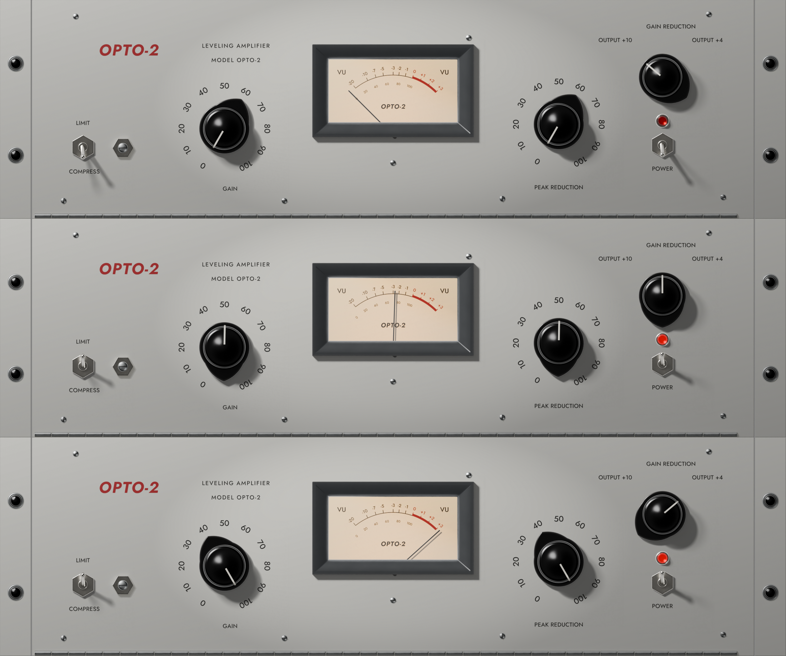

# vst-assets

Skeuomorphic UI assets for audio plugins, rendered from code. A JSON spec describes a plugin's front panel. Headless Blender renders it into a backplate, vertical filmstrips for knobs, switches, lamps and meter needles (each frame carries its own shadow), and static overlays. A manifest records sizes, frame counts, and each frame's angle or state for the plugin's editor.

The first panel is an LA-2A-style opto leveler. See issue #1 for the spec and `GLOSSARY.md` for the vocabulary.

Its Final render ships in `assets/opto_leveler/`: the backplate, a filmstrip per control, the VU meter's bezel and glass overlay, `manifest.json`, and a contact sheet.



To render with Claude Code, use the `vst-assets` skill in `.claude/skills/`.

## Requirements

- Blender 5.2.3 LTS (`brew install --cask blender`)
- Python 3 with Pillow, for the packing tools

## Render

```sh
blender -b --factory-startup -P blender/render.py -- specs/<name>.json [--final]
python3 tools/pack.py out/<name>
```

A Draft (16 samples, 1×, at most 16 frames) by default; `--final` renders with Cycles at the spec's scale. Output goes to `out/<name>/`, and the files to ship to `out/<name>/final/`.

A spec with `"target": "reason"` renders a Reason Rack Extension GUI instead: front, back and folded panels at Reason's sizes, and `out/<name>/final/GUI2D/` with the images and `device_2D.lua` (ADR 0008). `specs/reason_smoke.json` is a small example.

## Refs

Put reference photos in `refs/<name>/` (never committed) and list their file names in the spec's `notes.refs`. Then:

```sh
python3 tools/refboard.py specs/<name>.json
```

This writes `out/<name>/moodboard.png` and prints each photo's dominant colours, to write the look brief from. Once the spec lists refs, `pack.py` also writes `out/<name>/compare.png`: the contact sheet beside the moodboard.

## Textures

A panel (`panel.texture`) or a VU meter face (`face.texture`) can take an image, given as a path from the repo root, which replaces its colour and is stretched over the surface. Commit only images you have the rights to.

